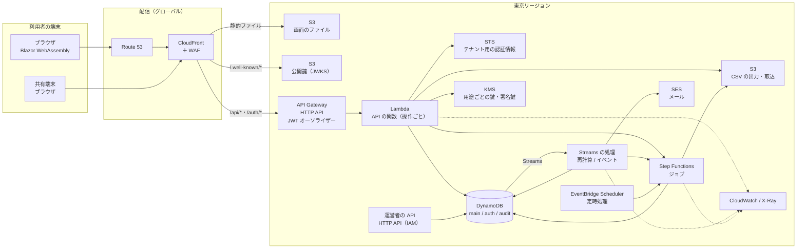

# 全体構成

システムの全体の構成（AWS のサービスの組み合わせ、関数、非同期の処理、環境、デプロイ、監視、画面の作り）。データの置き方は [データ設計](data-model.md)、API は [API 仕様](../api/README.md)。

## 1. 方針

| 項目 | 方針 |
| --- | --- |
| 画面 | Blazor WebAssembly を S3 に置き、CloudFront から配る。部品のライブラリを使う（§13） |
| 入口 | CloudFront で、アプリと同じオリジンの `/api/*`・`/auth/*` を API Gateway（HTTP API）に振り分ける。WAF は CloudFront に付ける |
| 認証 | 独自 JWT。HTTP API の JWT オーソライザーで検証する |
| API の関数 | 操作（operationId）ごとに1つの Lambda 関数。ハンドラはソース生成のライブラリで書き、足りない機能はライブラリに加える。テナント向け122、運営者向け10 |
| 起動の対策 | API の関数はすべて Native AOT（カスタムランタイム、arm64）。SnapStart は使わない |
| 型の生成 | OpenAPI から C# の型とクライアントを生成し、型はサーバーと画面で共有する |
| データ | DynamoDB（業務・認証・監査）、S3（ファイル）、用途ごとのカスタマーマネージドキー |
| 非同期の処理 | 業務テーブルの Streams を2つの関数で読む（再計算／それ以外のイベント） |
| ジョブと定時処理 | Step Functions（標準ワークフロー、分散マップ）。定時処理は EventBridge Scheduler（Asia/Tokyo）から起動する |
| 環境 | 開発・検証・本番を別の AWS アカウントにし、AWS Organizations と IAM Identity Center で管理する |
| デプロイ | CDK（C#）。当面は手作業で `cdk deploy` する。CI/CD の自動化は後で決める（§14） |
| ネットワーク | Lambda は VPC に入れない |
| 監視 | CloudWatch（ログ、メトリクス、アラーム、ダッシュボード）と X-Ray |
| リージョン | 東京（ap-northeast-1）。CloudFront 用の証明書と WAF はバージニア北部（us-east-1） |

## 2. 構成図

## 3. 入口

### 3.1 CloudFront

| パス | オリジン | キャッシュ | 備考 |
| --- | --- | --- | --- |
| `/_framework/*` | S3（画面のファイル。OAC） | 長期（ファイル名に指紋が付くため変わらない） | 発行で作る `.br` を置き、CloudFront Functions で `accept-encoding` に `br` があるときだけ `.br` に書き換える（`Content-Encoding: br` と元の `Content-Type` を付けて置く）。CloudFront の自動の圧縮は使わない。同じ書き換えを、上記以外のパスの JS・CSS（部品のライブラリの `/_content/*` など）にも行う（部品のライブラリの CSS は 624KB → 42KB になる）。設定は「上記以外」と同じなので、同じ振る舞い（既定の振る舞い）で配る |
| `/.well-known/*` | S3（公開鍵。OAC） | 5分 | discovery（`openid-configuration`）は S3 に置かず、CloudFront Functions が要求の Host から `issuer`（`https://{Host}`）と `jwks_uri` を組み立てて返す。JWKS は S3 に置き、認証の鍵の管理の関数が書き直す（§3.3）。署名鍵の切り替えは、このキャッシュとオーソライザーのキャッシュ（最大2時間）を待ってから行う。WAF のコアのルールを当てない（§3.2） |
| `/api/*`、`/auth/*` | API Gateway | しない | HTTPS だけを受け付ける。`Host` を除く閲覧者のヘッダー（`Authorization` を含む）とクエリを渡す。Cookie は `/auth/*` だけに、リフレッシュトークンと共有端末の2つだけを渡す（`/api/*` には渡さない）。CloudFront Functions が閲覧者の IP を `X-TNA-Viewer-IP` に入れ（閲覧者が送った値は上書きする）、オリジンへの要求に合言葉のヘッダー（§3.3）を付ける |
| 上記以外 | S3（画面のファイル） | `index.html` はしない、ほかは長期 | 画面の中の URL は、CloudFront Functions で `index.html` に書き換える |

- 独自のドメインを Route 53 で管理し、証明書は ACM（us-east-1）で発行する。環境ごとにサブドメインを分ける（例 本番 `app.{domain}`、検証 `stg.{domain}`、開発 `dev.{domain}`）。
- ドメインを用意するまで（時期は [実装計画と進捗](../plan.md)）は、CloudFront の既定のドメイン（`*.cloudfront.net`）と既定の証明書を使う。既定の証明書は TLS の下限を変えられないため、cdk-nag の CFR4 は、ドメインを設定するまでの間だけ理由を付けて認める。
- アクセスログは標準ログ（v2）で、東京のアクセスログのバケット（`cloudfront/`。90日で消える）に JSON で送る。S3 への配信は無料で、保管料だけかかる。配信の設定は us-east-1 で作る（CloudFront の決まり）。cdk-nag（CFR3）と Security Hub（CloudFront.5）は旧方式のログしか見ないため、理由を付けて認める。旧方式は ACL を有効にしたバケットが要るため使わない。
- 接続元の国は制限しない（出張や海外の拠点からも使うため）。攻撃には WAF で備え（§3.2）、cdk-nag の CFR1 は理由を付けて認める。
- 応答ヘッダーのポリシーで、HSTS、`X-Content-Type-Options: nosniff`、フレームの禁止（`frame-ancestors 'none'`）、`Referrer-Policy` を付ける。Content Security Policy の `script-src` は index.html の `meta` に書く（`'self' 'wasm-unsafe-eval'` と、インラインの importmap のハッシュ。ハッシュは配備のたびに変わるため、発行のスクリプトで計算して入れる）。同じ `meta` に、`connect-src 'self'`（通信は自分のオリジンだけ）、`object-src 'none'`、`base-uri 'self'`、`form-action 'self'` も書く（万一 XSS があっても、メモリのトークンを外へ送れないように）。`frame-ancestors` は `meta` では効かないため、応答ヘッダーで付ける。
- 利用者の IP（監査ログ、打刻）は、共通の処理が、合言葉を確かめた要求でだけ `X-TNA-Viewer-IP` から取る（§4.3）。CloudFront の `CloudFront-Viewer-Address` は、`Host` を除いてすべての閲覧者のヘッダーを渡す設定と一緒に使えないため（API Gateway は `Host` が自分の名前でないと断る）、CloudFront Functions で同じ値（閲覧者の IP）を入れる（配備で確かめる）。
- 画面の中の URL の書き換えは、配信全体のエラー応答（403・404 を `index.html` にする）では行わない。`/api/*` のエラーまで HTML に変わってしまうため。
- 料金は従量にする。定額の料金プランの Free では、自作の応答ヘッダーのポリシー、ログインだけにかける回数の制限、60秒の回数の制限、独自の 429 の応答が使えない。利用者が増えたとき（10万人で Business が割安の見込み）に見直す。

### 3.2 WAF

| ルール | 内容 |
| --- | --- |
| マネージドルール | 一般的な攻撃（コアルールセット）、既知の悪い入力、IP の評判。コアルールセットは `/.well-known/*` に当てない（scope-down）。API Gateway は JWT オーソライザーのために discovery と JWKS を取るとき User-Agent を付けないため、当てると `NoUserAgent_HEADER` で止められ、すべてのトークンが 401 になる |
| レート制限 | IP ごとに5分あたりの上限を設ける: `/auth/v1/login` 300、`/auth/v1/password/forgot` 30、`/auth/v1/kiosk/*`（共有端末の登録とトークン）60、`/api/v1/kiosk/sessions`（共有端末の照合）2,000。超えたら 429 を返す（独自の応答。本文は Problem Details の `RATE_LIMITED`、`Retry-After: 60`。WAF の本文は決まった内容のため `instance` は空で、`Content-Type` は `application/json`）。WAF の数え方には遅れがあり、60秒で10回の試験では、止まり始めるまで約30秒、解けるまで約1分半かかった。会社の NAT の後ろの利用者は同じ IP になるため、ログインなどのパスの上限は低くし、`/api/*` 全体には高めの上限（5分で30,000。値は負荷試験で確かめる）だけをかける。パスは、URL の復号、正規化（`//`・`./`・`../`）、小文字への変換をしてから前方一致で比べる（書き方を変えたパスで外せないように）。コアルールセットの `/.well-known/*` の除外も同じ |
| 本文の大きさ | CSV の取込（最大4MB）は、本文の検査の上限を超えるため、超えた部分を検査しない設定にする（コアルールセットの `SizeRestrictions_BODY` を Count にする。アプリで大きさを確かめる） |
| ログ | 止めた要求と数えた要求だけを、us-east-1 の CloudWatch Logs（`aws-waf-logs-tna-{env}`。90日）に残す。誤検知を後から調べるため（サンプルは3時間分しかない）。`Authorization` と `Cookie` は伏せる。100万要求あたり 500MB まで無料 |

### 3.3 API Gateway（HTTP API）

- ルートは関数の一覧（OpenAPI の操作と、実装したハンドラを突き合わせたもの。§4.4）から作る。各ルートに、その操作の関数を結び付ける。まだ実装していない操作のルートは作らない。
- JWT オーソライザーで、発行者（`https://{app のドメイン}`。ドメインを用意するまでは CloudFront の既定のドメイン）、対象者（`tna-api`）、期限、スコープ（操作の `security` の値）を確かめる。公開の操作（ログインなど）と Cookie の操作（リフレッシュトークン、共有端末の Cookie）にはオーソライザーを付けず、Cookie は関数が確かめる（cdk-nag の APIG4 は理由を付けて認める）。
- API Gateway は、JWT オーソライザーを作るときに発行者の `/.well-known/openid-configuration` を取りに行き、取れないと作成に失敗する。discovery は CloudFront Functions が返すため（§3.1）、オーソライザーは CloudFront（Web のスタック）の後のスタックで作る（§8.1）。作るときには JWKS も取りに行き、鍵が1つもないと作成に失敗する。JWKS は、オーソライザーのスタックより先に公開する。公開は認証のプロジェクトの鍵の管理の関数（`tna-{env}-signing-keys`）が行う: CDK が配備のときにカスタムリソースとしてこの関数を直接呼び、関数は `cdk.json` の世代の鍵の公開鍵を KMS から読んで、まだない世代を「次」として署名鍵の状態に書き、JWKS（公開鍵のバケットの `.well-known/jwks.json`）を書き直す。最初の鍵はすぐ「使用中」にする。1時間ごとの定期の実行が、公開から2時間5分（オーソライザーのキャッシュと CDN の5分）たった「次」を「使用中」に、それまでの鍵を「退役中」にし、退役中を1時間後に「退役」にして JWKS から外す。定期の実行は毎回 JWKS を書き直す。JWT のルートが1つもないうちは、オーソライザーを作らない。
- JWKS に鍵を足すと、オーソライザーはすぐに受け付ける（知らない `kid` で取り直すとみられる）。鍵を外しても、古い JWKS を持つ処理系がしばらく残り、外した鍵が通る（計ったところ68分以上。AWS の文書では最大2時間）。緊急時の失効は、共通の処理で発行時刻の下限を確かめて行う（§4.3）。
- HTTP API には WAF を直接付けられない。CloudFront を通らない要求を断るため、CloudFront がオリジンへの要求に付ける合言葉のヘッダー（`X-Origin-Verify`）を、すべての関数の共通の処理で確かめる（§4.3）。値は Secrets Manager のシークレット（`tna/{env}/origin-verify`。JSON の `current` と `previous`）に置く。CloudFormation が値を作り（`current`）、CloudFront は動的参照で受け取る（値はテンプレートにもログにも残らない）。Systems Manager の SecureString は、CloudFormation の動的参照で CloudFront に渡せない（`ssm-secure` は RDS のパスワードなど決まったリソースだけ）ため使わない。関数は5分ごとに読み直し、`current` と `previous` の両方を受け付ける。値が空なら関数は要求を受け付けない。
- 合言葉の切り替えは手作業で行う: (1) 新しい値を `current`、今の値を `previous` にしてシークレットに置く、(2) 5分以上待ってから、環境の設定（`cdk.json`）の `originSecretRotation` を1つ増やして Web のスタックを配備する（配信の説明が変わり、CloudFormation が新しい値を読み直す）、(3) CloudFront への反映を待って `previous` を消す。自動の切り替えはしないため、cdk-nag の SMG4 は理由を付けて認める。
- ステージは `$default` だけにし、アクセスログ（JSON。`/aws/apigateway/tna-{env}-api`。保持は90日、開発は1週間）を残す。アクセスログには、ルートに当たらない要求（404）は残らない（CloudFront のログには残る）。スロットリングは、ルートごとの既定を毎秒 1,000・バースト 2,000 にし、打刻はバーストの上限を高めに、出力などの重い管理の操作は低めに、操作ごとの値を関数の設定ファイル（§4.4）に書く（値は負荷試験で決める）。ルートごとの値はルートがないと設定できないため、ステージはルートの後のスタックで作る（§8.1）。
- 運営者の API は、別の HTTP API にし、IAM 認証にする。CloudFront からは公開しない。ステージとアクセスログ（`/aws/apigateway/tna-{env}-ops-api`）は本体と同じ作りにする。

## 4. Lambda の関数

### 4.1 共通

| 項目 | 内容 |
| --- | --- |
| ランタイム | カスタムランタイム `provided.al2023`（Native AOT。§4.5）、arm64 |
| 作り | ソース生成のライブラリで、ハンドラのクラスをリソース（パスのまとまり）ごとに書く。1つの操作（ハンドラ）に1つの関数。関数名は `tna-{env}-{operationId}`。書き方の約束とライブラリの拡張は、手元の `__handler-library.md` |
| メモリ | 既定 1,024MB。負荷試験で関数ごとに調整する（関数の設定ファイル。§4.4） |
| タイムアウト | API の関数は10秒（API Gateway の上限30秒より十分短くし、SDK の再試行の回数も絞る）。Streams の処理は60秒、ジョブの作業は最大900秒 |
| SDK の再試行 | 標準の再試行で2回まで（DynamoDB の SDK の既定は10回）、1回の待ちは2秒（S3 と関数の呼び出しは30秒）。遅いか throttle されたサービスを関数の時間の中で失敗させ（503。画面が再送する）、関数と同時実行を占めない。クライアントの設定は1か所（`AwsClients`）で作る。値は PoC-05 で確かめる |
| ログ | 関数ごとのロググループ（`/aws/lambda/tna-{env}-{operationId}`）。JSON のログ形式で、アプリは INFO 以上、Lambda のシステムのログは WARN 以上。保持は90日（開発は1週間） |
| トレース | Lambda の X-Ray（§9） |
| 同時実行 | 本番のアカウントの上限を 3,000 以上に上げる。打刻の2関数に予約同時実行を付ける（値は負荷試験で決める） |

### 4.2 プロジェクトと関数

関数のコードはモジュールごとのプロジェクト（アセンブリ）にまとめ、同じプロジェクトの関数は同じパッケージを使う（ハンドラの指定だけが違う）。

| プロジェクト | 関数の数 | 中身 | 権限のセット |
| --- | ---: | --- | --- |
| Auth | 29＋内部2 | 認証（`/auth/v1/*` の15）、アカウントの操作（6）と従業員の削除、退職の取消（アカウントを戻すため）、本人の PIN の設定、共有端末の照合と初期 PIN の変更、共有端末の登録・登録コードの発行し直し・失効。内部の関数（署名鍵と JWKS の管理、アカウントの作成） | 認証 |
| Punch | 2 | 本人の打刻、共有端末の打刻 | テナント用（＋共有端末の受付の読み取り） |
| Self | 12 | 本人の情報・当日・勤怠・予定・休暇・申請、申請の詳細と操作、承認待ちの一覧 | テナント用 |
| AdminOps | 33 | 管理の勤怠・シフト・締め・休暇（休業の記録を含む） | テナント用（＋ジョブの起動、ファイル、監査ログの検索） |
| AdminSettings | 46 | 管理の設定（アカウントの操作、従業員の削除、共有端末の登録を除く） | テナント用（＋ジョブの起動、ファイル） |
| Ops | 10 | 運営者の API | 運営者 |
| Async | 約20 | Streams の処理（2）、ジョブの作業、定時処理の作業、メールの配信状況の処理 | テナント用（＋ジョブ、メール） |

- 実行の役割（IAM ロール）は関数ごとではなく、権限のセットごとに作る（[データ設計](data-model.md) §12.2）。関数は自分のセットの役割を使う。
- CloudFormation の1つのスタックは500リソースまでのため、プロジェクトごとにスタックを分ける（1関数あたり約5リソース）。
- API のルートのない内部の関数（認証の `tna-{env}-signing-keys` と `tna-{env}-provision-account`）は、関数の一覧に載らないため、CDK が名前とハンドラを決めて作る（§8.1）。アカウントの作成の関数は、運営者の関数（テナントの開設）と、後で管理の設定の関数（従業員の登録）が同期で呼ぶ（[データ設計](data-model.md) §9）。共通の処理のフィルターは HTTP API の要求だけに働き、内部の関数のイベントはそのまま通す。

### 4.3 共通の処理

すべての API の関数は、共通の処理を通して本体を呼ぶ。共通の処理は、ハンドラのライブラリのフィルター（呼び出しの前後に処理を差し込む仕組み）で作り、プロジェクトの既定としてすべてのハンドラに付ける。コードは `Tna.Backend.Functions`。

| 順 | 処理 | 断るとき |
| --- | --- | --- |
| 1 | 例外とエラー（引数の読み取りと検証の失敗を含む）を Problem Details に変え、`instance` に要求の ID を入れる。すべての応答に `Cache-Control: no-store` を付け、要求ごとに1行の要約のログを書く（§9） | — |
| 2 | 合言葉のヘッダー（`X-Origin-Verify`）を確かめる（§3.3） | 403 `FORBIDDEN` |
| 3 | 操作を `routeKey` で操作の表から引き、要求の文脈を作る。利用者の IP は、2 で合言葉を確かめた要求では `X-TNA-Viewer-IP`（§3.1）、ほかは API Gateway の接続元。アクセストークンは種類（`typ` が `at+jwt`。オーソライザーは確かめない）とクレーム（下の表）を確かめる。Cookie の操作は `X-TNA-Request: 1` を確かめる（API 仕様 §2.2） | 401 `UNAUTHENTICATED`、403 `CSRF_HEADER_MISSING` |
| 4 | テナント用の認証情報を用意する（§6） | 500 |
| 5 | テナントの状態と、トークンの発行時刻の下限を確かめる（設定は60秒キャッシュ。下限は緊急時の失効に使う）。テナントの設定はテナント用の役割で読むため、4 の後に置く | 403 `TENANT_SUSPENDED`、401 |
| 6 | スコープとロール（`x-required-roles`）を確かめる。`admin` スコープの操作は、セッションの「最後の管理操作の時刻」を、再認証から12時間・最後の管理操作から1時間の条件付きで更新する | 403 `FORBIDDEN`、403 `REAUTH_REQUIRED` |
| 7 | 経路とクエリの引数を、操作の表の制約（仕様から生成。ID の形、件数の範囲、日付、列挙など）で確かめる。本文のある操作は `Content-Type` が仕様の形式かも確かめる | 400 `VALIDATION_FAILED`、415 `UNSUPPORTED_MEDIA_TYPE` |
| 8 | 冪等キー（必要な操作だけ）と `If-Match` を確かめる。冪等キーがすでに使われていたら、最初の応答を返すか断る（API 仕様 §2.5） | 400、409、412、422、428 |
| 9 | 本文を読み取り、仕様から生成した検証で確かめてから（ハンドラのライブラリ）、本体を実行する | 400 `VALIDATION_FAILED` |

- 利用者・テナント・ロール・要求の ID・時刻・打ち切りのトークン・テナントの状態・冪等キー・`If-Match` の版は、呼び出しごとの「要求の文脈」（`ApiRequestContext`）に入れ、本体はそこから読む。要求の ID は API Gateway の要求の ID。
- 勤怠管理者の管理範囲（部署）は、対象の勤務日の所属で決まるため、フィルターではなく各操作がリソースのデータで確かめる。
- 認証のプロジェクトはテナント用の役割を使わず、自分の役割でテーブルを読む（4 を付けない）。運営者の API は CloudFront を通らず、テナントもない（2、4、5 を付けない）。API のない関数のプロジェクト（Async）はフィルターを付けない。生成の道具が、プロジェクトのフィルターと順番をこの組み合わせと突き合わせ、違えば誤りにする（付け忘れた認可で管理の操作が通らないように）。
- 冪等キーの記録は、本体が業務の書き込みと同じトランザクションに入れる（[データ設計](data-model.md) §7.9）。キーがすでに使われていて書けなかったときは、8 が記録を読み、同じ要求なら保存した応答を返し、違う要求なら 422、処理中なら 409 を返す。24時間を過ぎた記録は消して、1回だけやり直す。
- 監査ログは、本体が業務の書き込みと同じトランザクションに足す。操作者・相関 ID（要求の ID）・IP・ユーザーエージェント・保存期間は、要求の文脈から入れる。

操作ごとの条件（認証の種類、スコープ、必要なロール、冪等キーと `If-Match` が要るか、引数の制約）は、OpenAPI から生成した操作の表を使い、関数のコードには書かない。本文の検証も、OpenAPI から生成したもの（§4.4）を使う。PATCH の本文（マージパッチ）は、本体が今のリソースに反映してから、同じ検証で確かめる（API 仕様 §2.7。反映の部品は最初の PATCH の機能で作る）。

アクセストークンのクレーム（認証の処理が発行する）:

| クレーム | 中身 |
| --- | --- |
| `sub` | 従業員の ID（`kiosk` スコープのトークンは共有端末の ID） |
| `tenant_id` | テナントの ID |
| `roles` | ロール（`tenantAdmin`、`attendanceAdmin`）を空白で区切る |
| `sid` | セッション（リフレッシュトークンの系列）の ID。最後の管理操作の時刻の記録に使う |
| `iat` | 発行時刻。緊急時の失効の下限と比べる |
| `name` | 表示用の氏名。監査ログの操作者に使う |
| `scope` | `employee`、`admin`、`kiosk`（JWT オーソライザーがルートごとに確かめる） |

ほかに標準のクレーム `iss`（`https://{app のドメイン}`）、`aud`（`tna-api`）、`exp`（発行から15分）、`jti`（ULID）、`client_id`（`tna-web`）を入れる。ヘッダーは `alg: RS256`、`typ: at+jwt`、`kid`（公開鍵の JWK の拇印。RFC 7638）。署名は KMS の非対称鍵で行い、関数は使用中の鍵（認証テーブルの `SIGNKEY`）を5分キャッシュする。

関数の設定（CDK が環境変数で渡す。起動時に確かめ、足りなければ起動しない。手元の設定 `local` だけ、テナント用の役割と合言葉を省ける）:

| 環境変数 | 中身 | 要るプロジェクト |
| --- | --- | --- |
| `TNA_ENVIRONMENT` | `dev`・`stg`・`prod`・`local` | すべて |
| `TNA_MAIN_TABLE`、`TNA_AUTH_TABLE`、`TNA_AUDIT_TABLE` | テーブルの名前 | すべて |
| `TNA_TENANT_ROLE_ARN` | テナント用の役割（§6） | 認証を除く（運営者はテナントの開設で最初の項目を作るために使う） |
| `TNA_ORIGIN_VERIFY_SECRET` | 合言葉のシークレットの名前（`tna/{env}/origin-verify`。§3.3） | 運営者を除く |
| `TNA_WEB_ORIGIN` | 画面の URL（`https://{app のドメイン}`）。アクセストークンの発行者と、メールのリンクに使う | 認証 |
| `TNA_AUTH_KEY` | 認証の鍵のエイリアス（`alias/tna-{env}-auth`）。TOTP の秘密情報の暗号化に使う | 認証 |
| `TNA_MAIL_MODE`、`TNA_MAIL_FROM` | メールの送り方（`ses`・`outbox`）と送信元のアドレス（`ses` のとき）。本番は `ses` だけ（§5.4） | 認証 |
| `TNA_PUBLIC_KEYS_BUCKET` | 公開鍵のバケット（JWKS を書く） | 認証の鍵の管理の関数 |
| `TNA_PROVISION_ACCOUNT_FUNCTION` | アカウントの作成の関数の名前（§4.2） | 運営者（後で管理の設定） |

### 4.4 OpenAPI から作るもの

| 生成物 | 元 | 作り方 | 使う所 |
| --- | --- | --- | --- |
| C# の型（サーバーと画面で共有） | 結合した OpenAPI（`docs/api/dist`。本体と運営者） | `Tna.Contracts` のビルドの中で生成する（コミットしない）。運営者の API の型は名前空間を分ける（`Tna.Contracts.Ops`）。共通の型（Problem など）は本体の型を使う。型の決まらない JSON は `JsonElement` にし、知らない項目の辞書は作らない（型のテンプレートを1つ差し替える） | API の関数、Blazor の画面 |
| JSON のソース生成のコンテキスト（すべての型） | 生成した型 | 同上。本体（`TnaJsonContext`）と運営者（`TnaOpsJsonContext`）に分け、画面には運営者の型の読み書きを載せない | 型の読み書き（反射を使わない） |
| 画面用のクライアント | 本体の OpenAPI | 画面のビルドの中で生成する | Blazor の画面 |
| 操作の表（operationId、メソッド、パス、モジュール、認証の種類、スコープ、必要なロール、冪等キー、`If-Match`、経路とクエリの引数の制約、本文の形式） | 本体と運営者の OpenAPI | 生成の道具（`tools/Tna.Tools.Generator`）で作り、コミットする | 共通の処理（§4.3） |
| 入力の検証（要求の本文の型ごとの検証、必須の項目の一覧、パターン） | 本体と運営者の OpenAPI | 生成の道具で作り、`Tna.Contracts` に置いてコミットする。本体と運営者でファイルを分ける | 関数の本文の検証と JSON の読み取り、画面の入力の検証 |
| 関数の一覧（実装した操作ごとの、ルート、認証の種類、スコープ、ハンドラの名前） | 操作の表と、ビルドした関数のプロジェクト | 生成の道具が、ビルドした DLL を実行せずに読み、ハンドラ（メソッドとパス）を操作と突き合わせて作り、コミットする | CDK のルートと関数（§8）、手元の起動（§8.3） |

- 各操作を実装するモジュール（§4.2 のプロジェクト）は、OpenAPI の操作の `x-module` に書く。
- コミットした操作の表と関数の一覧が最新かは、生成の道具の確かめ（`--verify`）で確かめる。仕様を変えたときと、ハンドラを足したときは、生成の道具を動かす。
- 関数の一覧を作るとき、次を誤りにする: 操作のないハンドラ、`x-module` と違うプロジェクトのハンドラ、メソッドの名前が operationId の PascalCase でないもの、1つの操作に2つのハンドラ、共通の処理のフィルターがモジュールの組み合わせ（§4.3）と違うプロジェクト。ハンドラのない操作は、まだ作っていないものとして関数もルートも作らない（少しずつ実装して配備できる）。作り忘れは関数の数（例 126 のうち 2）で見て、公開の前にすべての操作に関数があることを確かめる。
- 関数のメモリ、タイムアウト、ルートごとのスロットリングは、関数の一覧とは別の設定ファイル（`src/Tna.IaC/function-settings.json`。手で書く）に、既定の値と操作ごとの上書きとして書き、CDK がまとめて読む。予約同時実行（値は負荷試験で決める）と、AOT から ReadyToRun に戻すときの起動の方式は、要るときに同じファイルに足す。設定ファイルにあって関数の一覧にない操作は誤りにする（書き間違いに気付くため）。
- 入力の検証は、入れ子の「種類で形が変わる型」（補正の操作、承認者の決め方、再申請）を、実行時の型でそれぞれの派生の検証に振り分ける。生成の道具が扱わない制約（例 `uniqueItems`、`additionalProperties: false`、経路とクエリの引数の長さ、知らない `format`、2つ以上の型の `oneOf`）は、黙って捨てずに誤りにする。
- 型の生成の設定は、手元の `docs/api/__tooling.md`。

### 4.5 起動の対策

API の関数は、すべて Native AOT にする（カスタムランタイム `provided.al2023`、arm64）。SnapStart は使わない。

| 方式 | 冷えた状態の1回目（初期化と処理の合計）の p50 / p99 | 費用 |
| --- | --- | --- |
| Native AOT（採用） | 打刻 328 / 394ms、当日の状態 280 / 343ms | なし |
| ReadyToRun | 打刻 990 / 1,427ms、当日の状態 959 / 1,065ms | なし |
| SnapStart（事前の呼び出しなし） | 打刻 1,615 / 1,824ms、当日の状態 1,588 / 1,894ms | スナップショットの保管と復元 |

- 数値は 1024MB、arm64 で計ったもの。AOT だけが、冷えた状態でも目標（打刻の応答の99%が1秒以内）を余裕を持って満たす。
- AOT の実行ファイルはプロジェクトごとに1つになる（関数のハンドラの設定で、動かすハンドラを選ぶ入口を、ライブラリの拡張で生成する）。ハンドラの名前はマネージドのランタイムと同じなので、問題があったときはプロジェクトごとに ReadyToRun に戻せる。
- 非同期の処理の関数（§5）も同じ作りで、AOT にする。

### 4.6 Native AOT に対応できる作りの約束

| 項目 | 約束 |
| --- | --- |
| JSON | System.Text.Json のソース生成だけを使う。Lambda では反射による読み書きを切る（`JsonSerializerIsReflectionEnabledByDefault=false`）。画面では切らない（Blazor と部品のライブラリの JS の呼び出しが反射を使うため）。種類で形が変わる型は、.NET 標準の `[JsonPolymorphic]` で表し、判別の項目の位置は問わない（`AllowOutOfOrderMetadataProperties`）。列挙は仕様の値（例 `monthlyVariable`）で読み書きする（型の生成の JSON の版を 9.0 にする）。関数のシリアライザーは、HTTP API のイベントの型のコンテキストと生成した型のコンテキストを組み合わせた自前のもの（`TnaLambdaSerializer`）。ライブラリは応答の本文を `object` として渡すため、実行時の型で書く（標準のソース生成のシリアライザーは宣言の型で探すため使えない） |
| 型の生成 | 生成する型に検査用の属性（DataAnnotations）を付けない。必須でない項目は null を許す型にする（数値・日付・列挙・真偽が、送られないと既定値にならないように）。入力の検証は、生成の道具が OpenAPI から作る検証で行う。パターンはソース生成の正規表現（`[GeneratedRegex]`）にする。必須の項目は、JSON の読み取りの設定（ソース生成のコンテキストに、型の情報を変える処理を足す）で確かめる |
| DynamoDB | AWS SDK v4 の低レベルの API を使う。項目の変換は、型をソース生成の JSON にして項目に写す汎用の変換で行い、大量に読む名簿だけ手書きにする（[データ設計](data-model.md) §3.2）。オブジェクト永続化モデル（反射を使う）は使わない |
| 依存 | 依存するライブラリは、AOT とトリミングに対応したものだけにする。ビルドで AOT の解析（`IsAotCompatible`）を有効にし、警告を残さない |
| 暗号 | パスワードのハッシュは .NET 標準の PBKDF2-HMAC-SHA256（60万回）にする（arm64・1024MB で 約0.24〜0.30秒）。Argon2id は使わない |
| DI | 起動時の登録を少なくし、反射での組み立てに頼らない |
| 設定 | 設定の読み込みと検証は、ソース生成（設定のバインドの生成、`[OptionsValidator]`）で行う |
| ログ | `[LoggerMessage]` のソース生成で書く。Microsoft.Extensions.Logging のログは、自前の小さな部品で Lambda のランタイムのロガーに渡す（テンプレートと同じ作り。値は JSON の項目になる） |
| ビルド | AOT は、Lambda と同じ Amazon Linux 2023 のビルド用のコンテナでビルドする（glibc の版を合わせるため）。arm64 は x86_64 のコンテナの中で、Amazon Linux 2023 の arm64 のライブラリを使ってクロスコンパイルできる（エミュレーションは要らない）。手作業のデプロイでは、開発者の手元にコンテナの実行環境が要る。カスタムランタイムの zip では、`bootstrap` に実行の権限を付ける |

- 生成した型（203個）は、反射を切り、ソース生成のコンテキストを使う条件で、AOT の解析の警告が0件になり、種類で形が変わる型の読み書きも正しく動く。
- 画面（Blazor）は WebAssembly の AOT を使わないが、トリミングをするため、同じ約束で作る（反射の JSON を切る設定だけは除く）。生成した画面のクライアントは、生成のテンプレートを差し替えてソース生成の JSON を使う（切り詰めの警告は0件）。

## 5. 非同期の処理

### 5.1 Streams の処理

業務テーブルの Streams を、2つの関数がそれぞれの条件で絞って読む（1つのシャードを同時に読めるのは2つまで）。

| 関数 | 読む項目 | 中身 |
| --- | --- | --- |
| 再計算 | Punch、PunchAdjustment、DayLeave、WorkSchedule、EmployeeAssignment、LeaveOfAbsence | 日別勤怠の再計算と、期間の集計、36協定の判定、未解決のエラーの索引（[データ設計](data-model.md) §8） |
| イベント | Request、ShiftPlanHead、LeaveGrant、Alert、Job など | 受信箱の入れ替え、休暇・打刻修正の反映と戻し、通知、期間の集計の件数、ジョブとシフト表の反映の起動 |

| 設定 | 値（初期値。負荷試験で調整） |
| --- | --- |
| まとめて受け取る件数・待ち時間 | 100件・1秒 |
| シャードあたりの並列度 | 再計算は10（朝の集中に備える）、イベントは2 |
| 失敗 | まとまりを半分に分けて再試行し、失敗したレコードだけを返す。5回失敗したら SQS の待ち行列（DLQ）に送り、アラームを出す |
| 除くもの | TTL による削除（`userIdentity` のあるレコード） |

- 再計算の関数は `tna-{env}-recalculation`（Async のスタック）。イベントソースは読み始めを TRIM_HORIZON にし（作り直しても記録を取りこぼさない）、関数は失敗した日のレコードを返す（ReportBatchItemFailures）。5回失敗したレコードは `tna-{env}-recalculation-failures`（SQS の管理する鍵で暗号化、14日）に入り、アラームを出す。U-04 では `Punch` の追加だけを受け取る（F2-03 で入力を足す）。イベントは要る項目だけの自前の型で読む。

受け手がさらに増えるときは、EventBridge Pipes でイベントバスに流して配る。

### 5.2 ジョブ

| ワークフロー | 起動 | 中身 |
| --- | --- | --- |
| 出力 | Job の作成（イベントの関数） | 範囲の従業員を求め、分散マップで100人ずつ CSV の部品を作り、1つのファイルにまとめて S3 に置く |
| 従業員の取込の反映 | Job の作成 | 検証済みの行を分散マップで登録・更新し、新しい従業員のアカウントを作る |
| 締め・再オープン | Job の作成 | [データ設計](data-model.md) §7.6 の手順。ロックと確定は分散マップで従業員ごとに並列に行う |
| 一括の再計算 | Job の作成（就業ルールの新しい版、カレンダー・条件の変更） | 分散マップで従業員ごとに、施行日以降の締めていない勤務日を再計算する |
| シフト表の反映 | シフト表の公開（イベントの関数） | 行ごとに勤務予定を書き、本人に知らせる |
| 保存期間の付け替え | 延長年数の変更 | 分散マップで、そのテナントの記録の TTL を付け替える |
| 定時処理 | EventBridge Scheduler（§5.3） | 分散マップでテナントごとに処理し、大きなテナントはさらに従業員ごとに分ける |

- 親は標準ワークフロー（必ず1回実行）、分散マップの子は Express ワークフローにする（作業は冪等にする）。
- 同時に動かす数の上限（MaxConcurrency）を設けて、DynamoDB と Lambda を守る。
- 進み具合と結果は Job の項目に書く（API の getJob で見られる）。
- 費用は、締め1回（3,000人）で数セント（標準ワークフローの状態遷移1回 $0.000025）。
- 計った時間は、3,000人の月次集計の出力 5.6秒、日別明細の出力 10.5秒、締め 8.7秒。1万人の日別明細（30万行）は同時実行20で 27.9秒、60で 15.7秒。まとまりは月次集計と締めで100人、日別明細で50人、同時実行は20から始め、大きなテナントは上げる。部品を1つのファイルにまとめる処理（S3 のマルチパートアップロード）は、部品200個で約6.5秒。

### 5.3 定時処理

| 処理 | スケジュール（Asia/Tokyo） |
| --- | --- |
| UC-BA-01 打刻漏れなどの通知 | テナントごとのスケジュール（テナントの設定の時刻。既定 8:00）。設定が変わったら、イベントの関数がスケジュールを作り直す。開設で作り、停止で止める |
| UC-BA-02、03、04、08、11 | 毎日（それぞれの時刻） |
| UC-BA-05 | 毎日 9:00 |
| UC-BA-07 | 毎日 9:00（前日に給与の締め期間の末日の打刻の受付期限を過ぎたテナントだけ算定する） |
| UC-BA-09 | 毎月1日 |
| UC-BA-06 | 再計算の中で行う（スケジュールなし） |
| UC-BA-10 | 運用の作業（毎月の費用の確認） |

- 1回だけのスケジュールは、実行後に自動で消す設定にする。
- スケジュールは EventBridge Scheduler のグループに置く。毎日・毎月の処理は `tna-{env}`、テナントごとの通知（UC-BA-01）は `tna-{env}-tenants`（名前は `{tenantId}-{処理}`）。テナントの開設・停止・設定の変更で、イベントの関数がテナントのグループのスケジュールを作り直す（その役割には、このグループのスケジュールの作成・変更・削除と、起動の役割の受け渡しだけを許す）。
- 起動の役割は1つ（`tna-{env}-scheduler`。Scheduler だけが引き受け、`aws:SourceAccount` で限る）を共有し、ワークフローの開始、関数の呼び出し、DLQ への送信だけを許す。
- 失敗した起動は、1時間・3回まで再試行し（遅れて届く通知を避ける。取りこぼした日は次の実行でまとめて行う）、共有の DLQ（`tna-{env}-schedule-failures`。SQS の管理する鍵、14日）に送って、送られた件数でアラームを出す。作るのは F1-04（土台）、F2-01、F2-05。
- 定時処理は「まだ処理していないもの」を処理する作りにし、停止や失敗で止まっていた日の分も次の実行でまとめて行う。

### 5.4 メール（SES）

- 本番は、送信元のドメインを検証し、DKIM、独自の MAIL FROM、DMARC を設定する。本番の送信を申請する（サンドボックスの解除）。
- 開発と検証はサンドボックスのまま使い、検証したアドレスにだけ送る。
- 設定セットで、バウンスと苦情を SNS 経由で関数に送り、その従業員のメールアドレスを「届かない」にする。
- 毎朝の打刻漏れの通知（UC-BA-01）は、送信の上限を超えないように、ワークフローで送る速さを調整する。送信の上限で間に合うかを PoC-07 で確かめる。
- 認証のメール（招待、TOTP の登録などの通知）は、認証の処理が書き込みの後に同期で送る。送り方は環境の設定（`TNA_MAIL_MODE`）で選ぶ: `ses` は SES（v2 の API）で送り、`outbox` は送らずに認証テーブルの控え（`OUTBOX`。1日で消える）に書く。SES とドメインの準備までの開発の環境と、手元・自動のテストは `outbox` にし、招待のリンクは控えから取り出す（準備の時期は [実装計画と進捗](../plan.md)）。本番の環境で `outbox` を選ぶと、関数は起動しない。
- 招待のメールを送れなかったときは、呼び出した操作を失敗にする（やり直すと新しい招待を作って送る）。通知のメールを送れなかったときは、エラーのログに残し、操作は成功のままにする。

## 6. テナント用の認証情報

- 業務の関数は、JWT で確かめたテナントの ID をセッションタグに付けて「テナント用の役割」を引き受け（AssumeRole）、その一時的な認証情報で DynamoDB と S3 を呼ぶ（[データ設計](data-model.md) §12.1）。
- 実行の役割には、テナント用の役割の引き受け（`sts:AssumeRole`、`sts:TagSession`）だけを許す。セッションタグの `tenantId` は必須にする。
- 認証情報は、テナントごとに関数の中でキャッシュする（有効期限1時間、50分で取り直す）。その認証情報で DynamoDB・S3・KMS（一覧の続きの鍵）のクライアントを作る。
- 手元の設定（`local`）では引き受けをせず、既定の認証情報を使う（§8.3）。
- STS はリージョンのエンドポイントを使う。関数の中での AssumeRole は 12〜14ms かかる。回数の上限は、朝の集中の負荷試験（PoC-05）で確かめる。

## 7. 環境とアカウント

| アカウント | 中身 |
| --- | --- |
| 管理 | 請求、Organizations、IAM Identity Center。システムは置かない |
| ログの保管（推奨） | 組織の CloudTrail と設定の記録を集める |
| 開発 | 開発者が使う。データは試験用だけ |
| 検証 | 負荷試験と、本番の前の確認 |
| 本番 | 顧客のデータ |

- 人は IAM Identity Center でサインインし（MFA 必須）、役割（管理者、開発者、読み取りだけ、緊急用）ごとの権限セットを使う。長期のアクセスキーは作らない。
- サービスコントロールポリシーで、組織からの離脱、CloudTrail の停止、使わないリージョンの利用（東京と、CloudFront 用のバージニア北部を除く）、ルートユーザーの利用を禁止する。
- 本番と検証は、Lambda の同時実行のクォータを上げ、DynamoDB の warm throughput を設定する。負荷試験は開発（PoC-05）と検証（公開の前）で行い、本番のクォータに影響させない。
- DNS は、サービスのドメインを本番に置き、`dev.`・`stg.` のサブドメインをそれぞれのアカウントに任せる。
- アカウントごとに AWS Budgets で予算を設定し、超えそうなら知らせる。

## 8. デプロイ（CDK）

### 8.1 CDK のアプリ

C#（.NET 10 SDK、Node.js 22 以上）で書く。環境ごとに同じスタックを作る。

| スタック | 中身 |
| --- | --- |
| Foundation | KMS の鍵（業務、認証、監査、ファイル、一覧の続き、HMAC、世代ごとの署名）、アラームの通知先（SNS）、ほかのスタックが読むパラメータ |
| Data | DynamoDB の3つのテーブル（PITR、TTL、Streams、削除保護、warm throughput、テーブルクラス）、S3 のバケット（ファイル、公開鍵、アクセスログ。アクセスログには CloudFront のログも入る） |
| Roles | 関数のプロジェクトごとの実行の役割、テナント用の役割 |
| Global（us-east-1） | WAF の Web ACL とそのログ（後で CloudFront 用の証明書） |
| Api | HTTP API の本体（ルートとステージは後のスタック）、合言葉のシークレット |
| Web | 画面のバケット、CloudFront、CloudFront Functions（画面の振り分けと `.br`、discovery）、応答ヘッダーとキャッシュのポリシー（後で Route 53 のレコード） |
| WebLogs（us-east-1） | CloudFront のアクセスログの配信（v2） |
| AuthInternal | 認証の内部の関数（署名鍵と JWKS の管理、アカウントの作成。§4.2）、鍵の管理のカスタムリソース、1時間ごとのスケジュール（EventBridge Scheduler）とその役割 |
| Authorizer | JWT オーソライザー（JWT のルートがあるときだけ） |
| ApiAuth、ApiPunch、ApiSelf、ApiAdminOps、ApiAdminSettings | 各プロジェクトの関数（ロググループ、メトリクスフィルター）とルート（§4.2。関数のあるプロジェクトだけ） |
| ApiStage | HTTP API のステージ（アクセスログ、スロットリング） |
| Async | Streams の処理、Step Functions のワークフロー、ジョブの作業、Scheduler のスケジュール、DLQ |
| Mail | SES の ID、設定セット、配信状況の処理 |
| Ops | 運営者の API（IAM 認証）、ステージ、関数とルート |
| Monitoring | ダッシュボード、アラーム |

- 関数とルートは、関数の一覧と、関数の設定ファイル（§4.4）から、ループで作る。1つの操作に、関数・ロググループ・メトリクスフィルター・ルート・結び付け（統合）・呼び出しの許可を作る部品を用意する。関数のパッケージはプロジェクトごとに1つで、ハンドラの設定で操作を選ぶ（§4.5）。関数の役割は Roles のスタックの役割を名前で使う。
- スタックの中は、役割ごとの部品（Construct）に分ける。
- スタック・テーブル・バケット・役割・鍵のエイリアスは、環境ごとに名前を固定する（`tna-{env}-…`。バケットは末尾にアカウント ID）。スタックの間は名前で参照し、名前で決まらない鍵・通知先・ストリーム・HTTP API・オーソライザー・配信の値は、作るスタックが Systems Manager のパラメータ（`/tna/{env}/…`）に書き、使うスタックが配備のときに読む。CloudFormation のエクスポートは使わない（鍵や役割を作り直しても、後のスタックが止まらない）。配備の順は、Foundation → Data → Roles → Monitoring、Roles の後に AuthInternal、Global → Api → Web → WebLogs、Web と AuthInternal の後に Authorizer → 各プロジェクト → ApiStage、Roles の後に Ops（依存を書いてあり、`cdk deploy --all` で順になる）。
- 鍵の利用は、キーポリシーだけで役割ごとに許す（[データ設計](data-model.md) §12.3）。検証と本番では、鍵の無効化と削除の予約を、IAM Identity Center の緊急用の権限セット（Emergency）だけに許す。開発だけは、管理者と開発者も DynamoDB と S3 を通して試験用のデータを読める。
- JWT の署名鍵は、環境ごとの設定に書いた世代ごとに作る（エイリアス `alias/tna-{env}-signing-{世代}`）。切り替えは、世代を足して配備し、認証の鍵の管理の関数が「次 → 使用中 → 退役中 → 退役」を進める（§3.3）。退役した世代の鍵を消すのは手作業。使用中・退役中の世代を `cdk.json` から消すと、鍵の管理の関数が配備を失敗にする。一度も署名していない「次」の世代が消えたとき（世代を足した配備の巻き戻しなど）は、断らずに退役にする（巻き戻しが止まらないように）。「次」を「使用中」に、それまでの鍵を「退役中」にする変更は、1つのトランザクションで行う（途中で止まって使用中の鍵が2つ残らないように）。
- 環境ごとの値（アカウント、署名鍵の世代、合言葉の切り替えの回数）は `cdk.json` の context に置き、`-c env=dev` のように選ぶ。アカウントを書いた環境は、別のアカウントの認証情報での合成を断る。`cdk.json` には、新しいプロジェクト向けの CDK の推奨の機能フラグも置く。開発の環境だけ「使い捨て」とし、削除の方針（DESTROY）、バケットの中身の自動削除、削除保護の解除、短いログの保持（1週間）にする。検証と本番は保持する（`RETAIN_ON_UPDATE_OR_DELETE`。作るときに失敗した資源は消すため、名前を固定した資源（バケット、ロググループ、待ち行列、シークレット）が、失敗した配備の後に残って次の配備を「already exists」で止めない。テーブルと鍵は保持のまま（テーブルは削除保護が巻き戻しを止め、鍵の削除の予約は緊急用だけに許すため））。保持した資源を、スタックを消した後に戻すときは、CloudFormation の取り込み（`cdk import`）でスタックに入れ直すか、空なら手で消してから配備する（どちらも、残った資源の名前と中身を確かめてから行う）。開発のスタックを消した後は、バケットの中身を消す仕組みのロググループが残るため、手で消す（鍵は7日後に消える）。
- すべてのリソースに、環境・システム・部品のタグを付ける（費用を分けて見るため）。
- CDK の CLI は `package.json` で版を固定し、`npx cdk` で動かす（手作業のデプロイでも結果を再現できるように）。
- 関数のパッケージは、プロジェクトごとに Native AOT で作る（Amazon Linux 2023 のビルド用のコンテナ。arm64 はクロスコンパイル。§4.6）。zip は `bootstrap` に実行の権限を付けて作り、CDK にはその zip を渡す。zip は `artifacts/functions/{プロジェクト}.zip` に置く（git の対象外）。作業の単位の検証と CDK のテストは、中身のない仮のパッケージで合成する（`-c functionPackages=placeholder`）。パッケージは `scripts/package.ps1` で作る（コンテナの実行環境が要る。コンテナの中の手順は `scripts/package-linux.sh`）。関数の一覧にないプロジェクト（Async）も含め、すべての関数のプロジェクト（`src/Tna.Backend.Functions.*`）を作る。発行の AOT の警告も誤りにする。NuGet のパッケージ、arm64 のライブラリ（sysroot）、dnf のキャッシュは、コンテナのボリュームに残して2回目から速くする。
- JWT オーソライザーは作るときに discovery と JWKS を取りに行くため（§3.3）、CloudFront（Web）の後のスタックで作る。discovery は CloudFront Functions が返すため、配備の途中の手作業は要らない。JWKS（鍵が1つ以上）は、オーソライザーのスタックより先に、AuthInternal のカスタムリソースが公開する。HTTP API の本体は、CloudFront のオリジンにするため先に作り、ステージは、ルートごとのスロットリングにルートが要るため最後に作る。
- WAF の Web ACL は us-east-1 に作り、CloudFront のスタックからはリージョンをまたぐ参照で使う。CDK の弱い参照（`cdk.json` の `@aws-cdk/core:defaultCrossStackReferences` が `weak`）は、CloudFormation の `Fn::GetStackOutput` で相手のスタックの出力を読むため、Lambda の仕組みもエクスポートも要らない（作る側を作り直しても止まらない。エクスポートを使わないのと同じ考え）。CloudFront のログの配信（us-east-1）も、同じ方法で配信の ARN を読む。
- cdk-nag（AWS Solutions と Serverless の規則）は CDK の検証の仕組みに登録し、指摘があれば合成を止める（警告の規則も止まる）。サービスの仕様でなくせない指摘（関数のロググループ、X-Ray と ListStreams の `*`、テナントのファイルの接頭辞）だけ、理由を付けて役割ごとに認める。サービスと設計の仕様でなくせない次の指摘も、理由を付けてリソースごとに認める: 公開と Cookie の操作のルートにオーソライザーがない（APIG4）、同期で呼ぶ API の関数に DLQ がない（LambdaDLQ。DLQ は非同期の呼び出しにしか効かない）、合言葉を自動で切り替えない（SMG4）、CloudFront のログが新方式（CFR3）、国を制限しない（CFR1）、独自ドメインまでの既定の証明書（CFR4）。認証の内部の関数の DLQ がない（LambdaDLQ）も、理由を付けて認める: アカウントの作成は運営者の関数が同期で呼んで誤りを受け取り、鍵の管理はカスタムリソース（失敗は配備の失敗になる）と1時間ごとの定期の実行（再試行2回。次の実行が JWKS を書き直す）で呼ぶ。CDK のテスト（`tests/Tna.IaCTests`）は、合成したテンプレートで、鍵・テーブル・役割・入口と環境ごとの違いを確かめる。どちらも作業の単位の検証で動く。cdk-nag 3.0.2 と CDK 2.273 の組み合わせでは、合成のときに jsii が型の読み込みの警告（`StackTemplates`）を出すが、cdk-nag の検査には影響しない。cdk-nag の版を上げたら消えるかを確かめる。

### 8.2 手順

当面は、開発者が Identity Center の一時的な認証情報で `cdk deploy` する。

1. 作業の単位の検証（`.claude/skills/verify/`）: ビルド（型の生成を含む。警告0）、テスト、InspectCode、改行。あわせて、OpenAPI の検証と結合、操作の表と関数の一覧が最新かを確かめる。
2. 関数のパッケージを作る。
3. `cdk diff` で変更を確かめてから `cdk deploy` する。本番は、2人目が差分を確認してから実行する。
4. 画面は、`index.html` をキャッシュしない設定、ほかを長期のキャッシュで S3 に置き、`index.html` だけ CloudFront のキャッシュを消す。手順は PowerShell のスクリプトにする（発行、importmap のハッシュを CSP の `meta` に入れる、指紋付きのファイルを `immutable` にする、Content-Type を直す、JS・CSS・WebAssembly などは発行で作る `.br` を `Content-Encoding: br` で置く）。古い版の指紋付きのファイルは、次の配備まで消さない（開いたままの画面が読み込みに失敗しないように）。スクリプトは `scripts/publish-web.ps1`: 環境の名前（Development・Staging・Production）で発行し、発行に `.br` のないファイルは作り、前の版のファイルを残してその前の版を消し（一覧はバケットの `_deploy/releases.json`）、`index.html` を最後に置く。`-DryRun` で、AWS を使わずに発行と置くファイルを確かめられる。

CI/CD は当面は手作業のままとし、自動化は後で決める（§14）。アカウントと Identity Center の用意は、ユーザーの作業（[実装計画と進捗](../plan.md)）。

### 8.3 手元での開発

- 手元の起動の仕組み（画面のテンプレートと同じもの）で、手元の DynamoDB（Streams を含む）、選んだモジュールの関数と HTTP API の模擬、画面をまとめて起動する。前に振り分けの部品を置いて、本番と同じく同じオリジンにする。
- 模擬にない JWT オーソライザーとテナント用の認証情報は、手元の設定のときだけ代わりの処理を使う。開発・検証・本番では、その切り替えが有効にならないことを起動時に確かめる。
- 手元は作業中の確認に使い、権限・CloudFront・オーソライザー・メールの確認は開発の環境で行う。
- 作り: 起動のプロジェクトは `src/Tna.AppHost`（`dotnet run --project src/Tna.AppHost`）。入口は `http://localhost:5100`。
  - 手元の DynamoDB は、結合テストと同じ版のコンテナを、資格情報によらず1つのデータベースにして起動のたびに空から使う。起動の始めに、準備の道具（`tools/Tna.Tools.Local`）が、テーブル（業務のテーブルには Streams）と署名の鍵を作り、テナント（設定は道具の `appsettings.json`）を運営者の API と同じ処理で開き、最初の管理者のパスワードを招待から設定する。
  - 関数は、関数の一覧のうち設定（`Local:Modules`。既定は Auth、Punch、Self）のモジュールのものを、Lambda の模擬に1つずつ登録し、HTTP API の模擬にルートを結び付ける。関数は本番のカスタムランタイムと同じ自分の入口（`_HANDLER` で操作を選ぶ）で動く。再計算の関数は Streams の模擬から受け取り、打刻でないレコードを読み飛ばす（絞り込みの条件は模擬にない）。運営者の API（IAM 認証）は手元では動かさない。
  - 署名の鍵（アクセストークン）と TOTP の秘密の鍵は、起動のたびに作って関数に渡し（`TNA_LOCAL_SIGNING_KEY`、`TNA_LOCAL_SECRET_KEY`）、関数のプロセスで共有する。HTTP API の模擬に JWT オーソライザーがないため、手元のときだけ共通の処理のフィルター（`LocalAuthorizerFilter`。合言葉の確かめの後）が、その鍵でトークンの署名・発行者・対象者・期限を確かめ、クレームを要求に入れる。合言葉は、振り分けの部品が手元用の値（起動のたびに作る）を付け、関数はその値と比べる。
  - 手元の切り替え（`TNA_LOCAL_*`）は、手元の環境の名前（`local`）のときだけ有効で、ほかの環境の設定にあれば関数が起動しない。AWS の資格情報は手元用のダミーにし、手元の関数が AWS を呼ばないようにする。

## 9. 監視と運用

| 対象 | 方法 |
| --- | --- |
| ログ | 構造化した JSON（Lambda の JSON のログ形式）。`[LoggerMessage]` の値は JSON の項目になり、Lambda の要求の ID と トレースの ID は自動で入る。要求ごとに1行の要約（`Request completed`。操作、状態、コード、時間、テナント、利用者、API Gateway の要求の ID）を書き、同じ呼び出しのほかのログとは Lambda の要求の ID で結ぶ。メッセージは英語。パスワード・トークン・PIN・TOTP のコードは出さない。保持は90日（開発は1週間） |
| 入口のログ | CloudFront のアクセスログ（S3、東京。§3.1）、WAF が止めた要求と数えた要求のログ（CloudWatch Logs、us-east-1。§3.2）、API Gateway のアクセスログ（CloudWatch Logs。§3.3）。保持は90日（開発は1週間。S3 は90日） |
| メトリクス | 打刻の件数と p99（関数の呼び出しの数と時間）、再計算の遅れ（Streams の IteratorAge）、エラーのコード別の件数、ジョブの時間。自前で出すのはエラーのコード別の件数だけで、要約のログを CloudWatch のメトリクスフィルターで数える（関数のロググループごとに、関数と一緒に作る）。状態が400以上の要約を、名前空間 `TnA/{env}`、メトリクス `Errors`、ディメンション `OperationId` と `Code` で数える（エラーのない時間はデータを出さない）。EMF は、.NET では JSON のログ形式で二重に包まれて認識されないため使わない |
| トレース | Lambda の X-Ray（API の5%ほどを抜き取り）。HTTP API は X-Ray に対応しないため、関数から始まる。コードには計装を入れない（X-Ray の SDK は 2027-02-25 にサポートが終わる。AWS の SDK の呼び出しの内訳は出ない）。JSON のログのトレースの ID で、ログとトレースを結ぶ |
| アラーム | API の 5xx と p99、Lambda のエラーとスロットリング、DynamoDB のスロットリング、Streams の遅れ、DLQ の件数、ワークフローの失敗、SES のバウンス率と苦情率、予算。SNS 経由で運用担当にメールで知らせる（宛先は環境ごとの設定 `cdk.json` の `alarmEmails`。トピックのポリシーで CloudWatch からの発行を許す）。再計算の失敗の待ち行列は、送られた件数で数える（2件目からも鳴る）。Streams の遅れは再計算の関数の IteratorAge が5分で60秒以上、API の 5xx は5分で5件以上で鳴らし、鍵の管理の関数のエラーでも鳴らす（値は PoC-05 で確かめる） |
| ダッシュボード | 朝の集中（打刻の件数、p99、同時実行、DynamoDB の書き込み）と、日々の状態 |
| セキュリティ | 組織の CloudTrail、GuardDuty、Security Hub（AWS の基本的なセキュリティのベストプラクティス）、IAM Access Analyzer |
| 費用 | AWS Budgets、毎月のテーブルクラスの確認（UC-BA-10） |

- 外部の監視サービスは使わない（必要になったら見直す）。
- 再計算の失敗の待ち行列には、失敗した記録の位置（シャードと番号）しか入らない。直すときの手がかりは、再計算の関数のエラーのログ（テナント・従業員・勤務日）にし、計算し直す入口は F2-03 で作る。

## 10. セキュリティの要点

| 層 | 対策 |
| --- | --- |
| 入口 | WAF（マネージドルール、レート制限）、TLS 1.2 以上、HSTS、Content Security Policy、CloudFront を通らない要求の拒否（§3.3） |
| 認証・認可 | JWT オーソライザー（署名、発行者、対象者、期限、スコープ）、共通の処理でのロールと管理範囲の確認、管理機能の再認証 |
| データ | テナント用の役割（`dynamodb:LeadingKeys`）、用途ごとのカスタマーマネージドキー、監査ログは追記だけ |
| 秘密情報 | コードに書かない。合言葉は Secrets Manager（CloudFormation が作り、CloudFront には動的参照で渡す）、署名と鍵付きハッシュは KMS で、鍵を外に出さない |
| 開発 | 依存ライブラリの脆弱性の検査、AOT の解析、cdk-nag |

## 11. 費用の見積もり

本番の月額（USD、東京）。従業員1万人、1年目。

| 項目 | 月額 | 根拠 |
| --- | ---: | --- |
| API Gateway（要求と転送） | 約12 | 月 約680万回（1人1日34回、月20日）、応答 4KB |
| Lambda（要求と実行時間、1GB） | 約12 | 同じ回数、1回 平均100ms |
| DynamoDB と KMS | 約33 | [データ設計](data-model.md) §15（6年目は約62） |
| CloudFront と WAF | 約29 | 従量。定額プランなら約15 |
| CloudWatch（ログ）と X-Ray | 約5 | 呼び出し1回あたり0.5KB のログ、5%の抜き取り |
| Step Functions、Scheduler、SES | 約5 | メールは月4万通ほど（$0.10/1,000通） |
| GuardDuty、Security Hub、Config | 約10 | 目安 |
| **合計** | **約106** | 6年目は約135 |

- 起動の対策（Native AOT）には費用がかからない（SnapStart を朝に集中する10ほどの関数に使うと、約$39 かかる）。
- 合言葉の Secrets Manager は1環境 月 $0.40 と読み取り（本番で月 $1 ほど）。CloudFront のログの S3 への配信は無料で保管料だけ、WAF のログは止めた要求と数えた要求だけのため、無料の枠（100万要求あたり 500MB）に収まる見込み。
- 開発と検証のアカウントは、利用が少ないため、それぞれ月 約$20〜40（WAF、鍵、監視の固定費が中心）。

## 12. まだ確かめていないこと

→ は確かめる時期（[実装計画と進捗](../plan.md)）。

- テナント用の認証情報（AssumeRole）の回数の上限と、キャッシュの効果 → PoC-05
- Streams の再計算の遅れ（朝の集中時）と、並列度の値 → PoC-05
- SES の送信の上限で、毎朝の通知が時間内に送れること → PoC-07

## 13. 画面（Blazor）の作り

参考ソース（画面のテンプレート）の作りを使い、次の点を直して使う。

| 項目 | 作り |
| --- | --- |
| 部品 | 部品のライブラリを使う。確認のダイアログ、通知、フォームの検証のつなぎ、基底の部品は、サーバーで描画するテンプレートのものを WebAssembly で使う |
| 文言と書式 | 画面の文言は日本語を直接書く（多言語の仕組みは作らない）。カルチャは ja-JP。照合とタイムゾーンのデータを含め、日本語を含む1つのファイル（`BlazorIcuDataFileName`）に固定する（ブラウザーの言語によらず日本語の書式になる）。全角と半角の違いは、パスワードとログインID ではサーバーでそろえる。企業コードは、API が形（半角の英数字）を確かめるため、画面が送る前に全角の英数字を半角にする。部品のライブラリの既定の文言（表のページ送りなど）は日本語に差し替える |
| トークン | アクセストークンはメモリだけに置き、singleton の部品で持つ。起動時に Cookie で更新を試み（`POST /auth/v1/token`、`X-TNA-Request: 1`）、期限の1分前にも更新する。期限は、受け取った時の端末の時刻にトークンの寿命（`exp` − `iat`）を足して数える（端末の時計がずれていても、更新を繰り返さない）。次の更新までは30秒以上あける。タブの中の同時の更新は1回にまとめ、タブをまたいだ更新は Web Locks で1つずつ行う（Web Locks のないブラウザーではタブの中だけでまとめる）。ほかのタブを40秒待っても順番が来ないとき（止まったタブがロックを持ったまま。ロックの中の要求は30秒で終わる）と、ロックが使えないときは、ロックなしで行う。更新できなければセッション切れとして、ログインの画面に移る（今の画面を `returnUrl` に入れ、「ログインの有効期限が切れました」と出す）。起動時の更新が通信やサーバーの誤り、想定外の例外で失敗したときは、セッションが有効なこともあるため、ログインの画面に移らずに再試行のボタンを出す |
| ログアウトとタブの間 | ログアウトは、更新と同じロックの中で、Bearer を付けない Cookie の操作用のクライアントで送る（ほかのタブの更新と重なって、古い Cookie を送らないように）。送るのは同時に1回で、通信が失敗しても、想定外の例外でも、タブのトークンは必ず捨てる。ログアウトと、更新で見つけたセッション切れとテナントの停止は、BroadcastChannel でほかのタブに知らせ、知らされたタブもトークンを捨ててログインの画面に移る（知らされた終わりは、ほかへ知らせ直さない。セッションのないタブは何もしない） |
| 端末に記憶するもの | 企業コードだけを localStorage に置く（AU01）。トークン、ログインID、氏名などは置かない。招待のリンクのトークン（`#token=`）は、読んだらすぐ URL から消す（履歴に残さない） |
| メニュー | 1つのアプリで、端末の画面の幅で出す機能を分ける。スマホは、簡単な機能（打刻と当日の状態、勤怠の確認、申請、承認、アカウント）だけを画面の下のタブに出し、タブにない項目は「その他」にまとめる。PC は、管理と設定を含むすべての機能を左のメニューに出す。共有端末は専用の入口とレイアウトにし、ほかの画面へは移れないようにする。ロールとスコープに応じて項目を出し分け、まだ作っていない画面の項目は出さない |
| API の呼び出し | 生成したクライアント（§4.4）に、Bearer を付けるハンドラを挟む（自分のオリジンへの要求だけ）。401 なら1回だけ更新して再送し、更新できなければセッション切れとしてログインの画面に移る。再送するのは、JWT オーソライザーの 401（Problem でない本文）と共通の処理の `UNAUTHENTICATED` のときだけ（パスワードや確認コードの誤りを2回送ると、ロックの数に2回入るため）。要求の時間切れは30秒（HTTP API の統合の上限。関数はそれより先に終わる）とし、通信の誤りとして扱う（呼び出し元が打ち切った要求は除く）。打刻は1回の送信を10秒で打ち切り、同じ冪等キーで再送する。クライアント、トークンとセッション、フォームの誤り、表示の書式は、部品と分けたライブラリ（`Tna.Frontend.Client`）に置き、トリミングと AOT の解析を有効にする。画面のアプリは部品だけを持ち、CA1515 と CA2007 だけを抑止する（ルーターは public の画面だけを見つけ、部品の続きは描画の文脈で動かすため） |
| ログインの後の移動 | `returnUrl` は、自分のオリジンの相対パスだけ許す（外のサイトへ移動させない） |
| JSON | 生成した型のソース生成のコンテキストを、クライアントの JSON の設定に入れる。生成のテンプレートを3つ差し替える。反射の JSON を切る設定は入れない（§4.6） |
| 入力の検証 | API と同じ検証（OpenAPI の制約から生成）を画面でも動かす。API の `errors[].field`（JSON Pointer）を入力の項目に結び付けて出す |
| 一覧 | 検索の条件を URL に入れる。ページ送りは「さらに表示」にする（`nextToken` は前にしか進めないため） |
| エラー | API のエラーはコードから文言を引いて出す。予期しない例外はレイアウトの ErrorBoundary で受け、再試行の操作を出す（ログインの後の画面と、ログインなどの認証の画面の両方のレイアウト） |
| 配信 | ファイル名の指紋を `index.html` にも反映し（`OverrideHtmlAssetPlaceholders`）、環境の名前は発行のときに決める（`WasmApplicationEnvironmentName`）。WebAssembly の AOT は使わない（§4.6。試したところ、起動は速くならず、大きさが2.2倍になった）。発行で作る `.br` を配り、CSP の `script-src` は発行のときに index.html の `meta` に書く。指紋の付かないファイル（index.html、CSS など5つ）は `no-cache` にする |
| 起動の時間 | 初回表示の目標（スマホの4Gで8秒、2回目は2秒）を外す主な原因は、大きさではなく起動の CPU の時間。スマホの実機（モバイル回線）で、見本の初回は 7.0秒、2回目は 1.8秒だった。読み込みの進み具合を index.html で見せる。従業員の最初の画面（打刻）は軽くし、表や日付の選択のような重い部品を置かない。管理の画面は別のアセンブリにして遅延読み込みにし、スマホでは読み込まない（軽量化の進め方は、H-01 で実機で計り直して決める） |
| 画面の幅 | スマホに出す簡単な機能の画面は、スマホ（幅360px以上）に合わせて作る |

## 14. 決めていないこと

→ は決める時期（[実装計画と進捗](../plan.md)）。

- CI/CD の自動化（当面は手作業で配備する。§8.2）→ 検証の環境を使う前（G4 の前）
- PoC で確かめて決める値（§12 と、[データ設計](data-model.md) §17）→ それぞれの PoC
