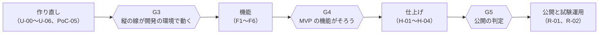

# 実装計画

これからの作り方と日程。進み具合は [進捗](progress.md)、いまの方針は [方針](../decisions.md)。2026-10-11 時点。

## 1. 進め方

| 項目 | 進め方 |
| --- | --- |
| 体制 | AI（コーディングエージェント）が実装とテストを進め、ユーザーが区切りごとにレビューして判断する |
| 作業の単位 | 動作を確かめられる単位で、プロジェクトと機能を足しながら進める。最低限の動作確認ができるところから始め、機能を足していく |
| 確かめ | 単位ごとに、検証（Release のビルドの警告0、テスト、InspectCode 0件、改行。`.claude/skills/verify/`）と動作の確認を行い、結果を報告する |
| コミットとプッシュ | 確認を得てから行う |
| 規約と AI の設定 | 変更は確認してから行う |
| 文書 | docs には残す価値のある文書だけを置く。仕様と設計の文書は、作る単位で要るものを、そのとき今の形で足す |
| 元にするもの | 検証のリポジトリ（`D:\GitHubTemplate\example-aws-tna`）で作って見直したコードと仕様を、このリポジトリの規則に合わせて書き直して移す |
| 日程 | 1日に約2依頼で見込む。区切りごとに実績で見直す（§8） |

## 2. 全体の流れ

| 区切り | 中身 | 完了の条件 | 判断する人 |
| --- | --- | --- | --- |
| G3 | 作り直し（§3） | 開発の環境で「テナントの開設 → 招待 → ログイン → 打刻 → 当日の状態 → 日別勤怠の再計算」が動き、検証がすべて通る。朝の集中の負荷試験（PoC-05）の結果が出ている | ユーザー |
| G4 | 機能（§4） | MVP の機能がすべて検証の環境で動き、機能の一式ごとのレビューが済んでいる | ユーザー |
| G5 | 仕上げ（§6） | 公開の条件（§6.1）を満たす | ユーザー |
| 試験運用 | 公開（§6） | 最初のテナントで1か月使い、評価する | ユーザー |

## 3. 作り直し（G3 まで）

大きさは依頼の数のおおよそ。

| ID | 単位 | 動作の確かめ | 大きさ |
| --- | --- | --- | ---: |
| U-00 | 規則のファイルと計画を整える: rules、検証の手順と台本、Tna.slnx、README、計画と進捗、方針 | 検証の台本が回る | 約0.5 |
| U-01 | ソリューションの土台と画面の骨組み（部品のライブラリ、日本語の書式、レイアウト） | 手元のブラウザで画面が出る。検証が通る | 約1 |
| U-02 | API の土台: OpenAPI と生成の道具（型、入力の検証、操作の表、関数の一覧）、ハンドラのライブラリと Native AOT の入口、共通の処理（エラー、要求の文脈、引数）、手元の起動（振り分け、Lambda と HTTP API の模擬） | 手元で画面から公開の操作（ログイン）を呼び、入力の誤りが画面の項目に出る | 約3 |
| U-03 | データと認証: 手元の DynamoDB と準備の道具（表とテナント）、データアクセス、署名鍵（手元）、ログイン・トークンの更新・ログアウト、招待とパスワードの設定、TOTP と管理の再認証 | 手元でログインしてホームに入り、更新とログアウトができる | 約3.5 |
| U-04 | 打刻と当日の状態、Streams の再計算（予定を使わない最小）、共通の処理の残り（テナント用の認証情報、テナントの状態、権限、冪等キー、ETag、監査ログ） | 手元で打刻し、当日の状態と日別勤怠の再計算の結果が出る | 約3 |
| U-05 | CDK（土台、入口、関数とルート、配信と WAF、監視とアラーム）と合成のテスト、関数のパッケージ（Native AOT、arm64）、画面の発行の台本 | 合成とパッケージと発行の確かめ（AWS を使わない）が通る | 約3.5 |
| U-06 | 開発の環境への配備と確かめ（アカウントの用意の後。AWS を使う前に確かめる） | 開発の環境で G3 の流れが動く。本物のログインと KMS の署名、JWT オーソライザー、TOTP、更新、再認証、ログアウト、Streams の再計算、失敗の待ち行列とアラームのメール、画面の配置と CSP、利用者の IP、2つのタブのログアウト | 約1 |
| PoC-05 | 朝の集中の負荷試験: 0から3,000件/秒まで60秒で上げる負荷と、9:00 ちょうどの集中 | 打刻の p99 が1秒以内、スロットリングなし、再計算の遅れが数秒以内 | 約2.5 |

- 移すコードは、検証のリポジトリで見直して直した後のもの。機能の作業で直すことは §4.1。
- PoC-05 は、同じリージョンの一時的な関数から、合言葉のヘッダーを付けて API Gateway を直接呼ぶ（CloudFront と WAF は通さない）。負荷用のアクセストークンは、開発の環境だけの一時の道具が KMS の署名で作る（本番と同じ鍵と形）。道具は .NET で作る。Lambda の同時実行のクォータ、予約同時実行、warm throughput、Streams の並列度、SDK の再試行の回数と待ちを決める。
- G3 の確かめのテナントの開設の呼び方（運営者の道具の `tenants create` を先に作るか、関数を直接呼ぶか）は、U-06 の前に決める。
- ハンドラのライブラリの拡張は、公開されるまで公開前のパッケージを使う（置き方は U-02 で確かめる）。公開されたら公開版に替える（約0.25依頼）。

## 4. 機能（F1〜F6）

機能の一式の順に作り、一式が終わるごとに検証の環境で動きを見せてレビューを受ける。1つの作業も、動作を確かめられる単位に分けて進める。設定の画面は、その値を使う機能の作業で足す。大きさは S（約1依頼）、M（約2.5依頼）、L（約5依頼）。

| ID | 作業 | 主な UC・画面 | 大きさ |
| --- | --- | --- | --- |
| **F1** | **組織と設定** | | |
| F1-01 | 管理の画面の土台（メニュー、入り方の確かめ、遅延読み込み）、TOTP の登録（EM10 の一部）と管理の再認証（AU05）の画面、部署、勤務パターン（半休の定義を除く）、カレンダーと祝日（運営者の祝日の登録の API とコマンドを含む）、テナントの設定（使う機能のある項目だけ）。開設の既定のデータに部署とカレンダーを足す | UC-SE-06、08、09、14、UC-AU-06、07 | L |
| F1-02 | 就業ルールと版（共通の土台と固定時間制の設定）、版の置き換え、雇用区分（就業ルールの後で作る）。開設の既定のデータに、勤務パターン、就業ルールの見本、雇用区分、既定の付与ルール（法定どおり）を足す | UC-SE-06、07 | M |
| F1-03 | 従業員（登録、変更、条件、退職（退職日の変更と退職の取消）、ロールと管理範囲、かな、削除、入社日の訂正）とアカウントの操作（PIN を除く）。最初の管理者に既定の条件を付けて名簿に載せる | UC-SE-01〜03、05、15、16、UC-AU-10 | L |
| F1-04 | 従業員の CSV の取込（検証と反映のジョブ。Step Functions の最初の利用。結果は画面に出す） | UC-SE-04 | M |
| F1-05 | 本人のアカウント（パスワードの変更と再設定、初期パスワードと、管理者が TOTP を解除した後のパスワードの変更、すべての端末からのログアウト）とセッションの失効。本人による TOTP の解除は作らない。PIN の設定は F2-06 | UC-AU-02〜05 | M |
| F1-06 | 監査ログの検索 | UC-AD-14 | S |
| **F2** | **打刻と勤怠（固定時間制）** | | |
| F2-01 | 計算エンジン: 勤務日の割り当て、区間と休憩、分の分類、日の結果。法定休日の判定は曜日・カレンダー・特定しないの3つ（4週4日は F4-02）。勤務予定の生成（UC-BA-08）、従業員の状態の切り替え（UC-BA-11。退職の処理で社員番号とメールアドレスの重複の確認を外す）、法定値の最初の版（配備で入れる）、就業ルールの休憩の扱いの画面 | 勤怠計算仕様 §4〜§6、UC-BA-08、11 | L |
| F2-02 | 計算エンジン: 時間外の判定と割り付け（日・週・期間）、月60時間、端数処理。就業ルールの月の端数処理と相殺の画面 | 勤怠計算仕様 §7、§9、§10 | L |
| F2-03 | 再計算の処理（範囲、版、修正履歴）と期間の集計、一括の再計算のジョブ、週の確定（UC-BA-02 の週の分） | 勤怠計算仕様 §12、UC-BA-02 | M |
| F2-04 | 本人の画面: ホーム（打刻、予定、警告、打刻のメモ、位置情報）、勤怠カレンダー、日別の詳細。テナント設定の位置情報の画面。本人のシフト（EM04）は F4-01 | UC-EM-01〜04 | M |
| F2-05 | 打刻漏れの通知（UC-BA-01。テナントごとのスケジュール）、メールの送信。テナント設定の通知の時刻の画面 | UC-BA-01 | M |
| F2-06 | 共有端末（登録、照合、打刻、初期 PIN の変更）と、共有端末の管理。本人の PIN の設定（EM10）、PIN のリセットと登録のときの初期 PIN | UC-KI-01〜03、UC-SE-13、UC-AU-08 | M |
| F2-07 | 管理: ダッシュボード（未解決のエラー。承認待ち・アラート・締めは、それぞれを作る作業で足す）、勤怠の一覧、従業員の勤怠と補正 | UC-AD-01〜03 | M |
| **F3** | **申請・承認と休暇** | | |
| F3-01 | 申請と承認の流れ（多段、受信箱、差戻し、取下げ、取消の申請と承認、管理者の取消）と、承認ルートの設定。開設の既定のデータに承認ルートを足す。ダッシュボードに承認待ちの件数を足す | UC-WF-03〜09、UC-SE-11 | L |
| F3-02 | 打刻修正申請（反映と戻し） | UC-WF-02 | M |
| F3-03 | 休暇種別の設定、休暇の残り（付与ロット、台帳）と休暇申請（検証、試算、反映、戻し、時間単位）、手動の付与と調整。勤務パターンの半休の定義の画面。開設の既定のデータに法定の休暇種別を足す | UC-WF-01、UC-EM-06、UC-SE-10、UC-AD-11 | L |
| F3-04 | 有給の付与（付与ルールの設定と時間単位年休の単位、付与予定、出勤率、失効）、休業の記録 | UC-AD-10、UC-BA-03、04、UC-SE-10、17 | L |
| F3-05 | 年5日の取得義務と時季指定、子の看護等休暇・介護休暇 | UC-AD-12、13、UC-BA-05 | M |
| **F4** | **シフトと労働時間制度** | | |
| F4-01 | シフト表（作成、検証、CSV、公開と反映）と予定の変更、本人のシフト（EM04）。テナント設定のシフトの変更事由の画面。期間の途中で所属が変わる人は、所属していた日のセルだけを割り当てる | UC-AD-04〜06、UC-EM-05 | L |
| F4-02 | シフト制と1か月単位の変形の計算（基準の予定、期間の判定、期間の途中の入社・退職・異動の按分）、法定休日の4週4日。就業ルールのシフト・変形の設定の画面 | 勤怠計算仕様 §6.4、§8.2、§8.3 | L |
| F4-03 | フレックスの計算（清算、過不足、繰越、期間の途中の入社・退職・異動と休業）。就業ルールのフレックスの設定の画面 | 勤怠計算仕様 §8.4 | L |
| F4-04 | 管理監督者・裁量労働・事業場外みなし、期間の確定（UC-BA-02 の変形期間・清算期間）。就業ルールの適用除外とみなしの設定の画面 | 勤怠計算仕様 §8.5、§8.6 | M |
| **F5** | **締め・出力・アラート** | | |
| F5-01 | 締めと再オープン（ジョブ、ロック、締めの版。締められるのは期間の末日の打刻の受付期限の後。範囲は期間の中に1日でも在籍した人）。ダッシュボードに締めの状況を足す | UC-AD-07 | L |
| F5-02 | CSV の出力（月次集計、日別明細、年次有給休暇管理簿。長時間労働者の一覧は F5-03）。テナント設定の CSV の形式の既定の画面 | UC-AD-08 | M |
| F5-03 | 36協定の設定と当てはめ（対象の細かいものを1つ）、アラート（36協定、安衛法、休憩不足など）と通知、長時間労働者の一覧の出力。ダッシュボードにアラートの件数を足す | UC-AD-09、UC-BA-06、07、UC-SE-12 | M |
| **F6** | **運用の機能** | | |
| F6-01 | 運営者の API とコマンドラインの道具（テナントの一覧・停止・再開、TOTP の解除、法定値の版。開設は作り直しで作る） | UC-OP-01〜03 | M |
| F6-02 | 保存期間（TTL、予告、付け替え）。テナント設定の保持期間の延長の画面 | UC-BA-09 | M |

順番の理由:

- F1 の従業員と就業ルールがないと、打刻も計算もできない。
- 計算エンジンは固定時間制（F2）で骨格を作り、シフト・変形・フレックス（F4）で広げる。休暇と申請（F3）は、日別勤怠への反映が要るため F2 の後にする。
- 締め（F5）は、すべての計算がそろってから作る。

### 4.1 機能の作業で直すこと

検証のリポジトリの見直しで見つけ、その機能の作業で直すことにしたもの。それぞれの作業の完了の条件に入れる。

| ID | 何をするか | 作業 |
| --- | --- | --- |
| FL-01 | 打刻の部品を、前日・当日・翌日の3日で勤務日と開いた区間を決める形にする（予定による勤務日の割り当てに要る） | F2-01 |
| FL-02 | エラーの重さ（打刻漏れと順序は error、休憩不足などは warning）を持ち、未解決のエラーの索引には error だけを載せる | F2-01 |
| FL-03 | 打刻の時刻に、関数の時計ではなく API の受信時刻を使う | F2-01 |
| FL-04 | 再計算を従業員ごとにまとめ、日・週・期間の範囲を1回で計算する | F2-03 |
| FL-05 | 入力がなくなった日の結果を消す、計算の版を上げたら締めていない日を計算し直す、締め済みの期間は計算しない | F2-03 |
| FL-06 | 失敗した日を、テナント・従業員・勤務日を指定して計算し直す入口（再計算の関数のエラーのログから） | F2-03 |
| FL-07 | 共有端末の打刻で、置き場所の決め方と書き込みを呼び出し元から切り離す。端末用のトークンを従業員のものと分ける | F2-06 |
| FL-08 | 補正の後の打刻から、当日の状態を導く部品 | F2-07 |
| FL-09 | テナントの設定の更新で、受付期限と日替わり時刻の組み合わせを確かめる | F1-01 |
| FL-10 | 管理の画面の土台: 権限のない人に「権限がありません」、再認証の 403 を AU05 につなぐ共通の仕組み、ロールでメニューを出し分ける、ダイアログのエラーの境界、遅延読み込みの受け口、部品の文言の日本語、一覧の「さらに表示」と条件の URL（氏名などの自由な文字は入れない） | F1-01 |
| FL-11 | 一覧の続きのトークンを、利用者とパーティションに結び付ける | F1-03 |
| FL-12 | 従業員とアカウントの書き込みを、属性ごとの更新にする（丸ごとの置き換えで、ほかの処理の更新を戻さない）。TOTP の解除と、初回のパスワードの変更の分岐を同じ作業で作る。セッションの失効は状態で行う | F1-03、F1-05、F2-06、F6-01 |
| FL-13 | TOTP のあるアカウントでも、古いパラメータのパスワードのハッシュを置き換える | F1-05 |
| FL-14 | 招待の画面のトークンを、画面の移動の仕組みでも消す。確かめの失敗にやり直しのボタン | F1-05 |
| FL-15 | ホームを、画面が見えたときと一定の間隔で取り直す。読み込みの途中で離れたときのタイマーを止める | F2-04 |
| FL-16 | 非同期の処理から監査ログを書くとき、テナントの延長年数と要求の時刻を引数で渡す | 最初の非同期の監査 |
| FL-17 | SES の権限（サンドボックスの宛先、送信元の限定） | SES への切り替え、F2-05 |
| FL-18 | 検証と本番では `account` を必須にし、本番で控えのメールなら合成を止める | U-05 |
| FL-19 | 手元の起動で、AWS に届かない宛先と、ない資格情報のファイルを指定する | U-02 |
| FL-20 | 署名鍵の切り替えの手順（巻き戻しの試験を含む） | H-03 |
| FL-21 | テストの抜け（同じ冪等キーの同時の要求、再計算の版の競合、受付期限の境目など） | それぞれの作業 |

## 5. テストの方針

| 種類 | 対象 | 方法 |
| --- | --- | --- |
| 単体 | 計算エンジン、ドメインの規則、入力の検証 | 勤怠計算仕様の計算例（A〜Q）と休暇仕様の計算例（L1〜L8）を、そのまま期待値にする |
| 性質 | 計算の不変条件 | 入力を自動で作って、「所定外 = 法定内残業 ＋ 法定外残業」「同じ入力なら同じ結果」「残りは負にならない」などを確かめる |
| 契約 | API の応答 | 生成されたハンドラを、要求のオブジェクトで直接呼び、応答を OpenAPI のスキーマで確かめる。エラーは Problem Details とコードを確かめる |
| 結合 | データアクセス | 手元の DynamoDB で、キー、条件付きの書き込み、トランザクションを確かめる（テストの開始時にコンテナを起こす） |
| 結合（AWS） | 権限と分離 | 開発の環境で、テナント用の役割が他のテナントのキーと Scan を拒否することを、自動のテストで毎回確かめる |
| 画面 | 主な流れ | 部品のテストと、ブラウザを動かす E2E（ログイン、打刻、申請と承認、締め）。E2E は ja-JP と Asia/Tokyo で動かし、失敗したときだけトレースを残す |
| 受け入れ | 認証と入口 | 開発の環境に対して、トークンなし、改ざん、`alg=none`、期限切れ、対象者の誤り、CloudFront を通らない要求、CSRF のヘッダーなしなどを、自動の試験で毎回確かめる |
| 負荷 | 朝の集中 | 検証の環境で、PoC-05 と同じシナリオを公開の前に再実行する |
| セキュリティ | 認証と認可 | OWASP ASVS の観点で確認し、依存ライブラリの脆弱性を検査する。公開の前に第三者の診断を受ける |
| 法令 | 計算の結果 | 試験運用の前に、代表的な勤務の組み合わせで、手計算の結果と突き合わせる |

## 6. 仕上げと公開

| ID | 作業 | 大きさ |
| --- | --- | --- |
| H-01 | 負荷試験と調整（検証の環境）。画面の初回表示を実機で計り直し、目標（スマホの4Gで8秒）を外れていたら軽量化する | M |
| H-02 | セキュリティの確認（ASVS、テナントの分離の試験、依存の検査、第三者の診断と指摘への対応） | L |
| H-03 | 監視・アラーム・ダッシュボードの仕上げ。運用の手順（障害の対応、PITR での復元の訓練、鍵の管理、テナントの開設、毎月のテーブルクラスの確認） | M |
| H-04 | 法令の確認（計算の突き合わせ（期間の途中の入社・退職・異動の按分を含む）、位置情報と IC カードの識別子の扱いの法務の確認）と、利用者向けの操作の手引き | M |
| R-01 | 本番の構築（クォータ、warm throughput、SES の本番の送信、ドメイン、WAF） | M |
| R-02 | 最初のテナントでの試験運用と、監視を強める期間 | M |

### 6.1 公開の条件（G5）

- MVP の機能がすべて動く。
- 非機能の目標を負荷試験で満たした。
- セキュリティの診断で、重大な指摘が残っていない。
- 法令の確認（位置情報の扱い、計算の突き合わせ）が終わった。
- 運用の手順がそろい、復元の訓練をした。

## 7. リスクと対策

| リスク | 影響 | 対策 |
| --- | --- | --- |
| 作り直しの見込み違い | 規則に合わせた書き直しが重く、G3 が遅れる | 最初の単位の実績で見込みを見直す。AWS を待つ間に作り直す |
| ハンドラのライブラリがベータ版 | 不具合や仕様の変更で手戻りが出る | 使う版を固定する。拡張はこちらで直してユーザーが確認する |
| 画面の起動が遅い | 遅いスマホで初回表示の目標（8秒）を満たせない | 実機の初回は見本で 7.0秒。最初の画面を軽くし、管理の画面は遅延読み込みにする。H-01 で計り直す |
| 約120の関数の管理の手間 | 配布と監視が煩雑になる | 関数・ルート・権限を OpenAPI から生成し、命名を規則で決める。監視はモジュール単位でまとめる |
| Native AOT に対応しないライブラリ | AOT を使えない | AOT に対応できる作りを守り、ビルドで解析する。だめならプロジェクトごとに ReadyToRun に戻せる |
| AOT のビルドの手間 | 配備が遅い。Windows では Lambda 向けに作れない | Amazon Linux 2023 のビルド用のコンテナでクロスコンパイルする |
| 計算の誤り | 給与の誤り、法令違反 | 計算例のテスト、性質のテスト、手計算との突き合わせ。暫定で決めた扱いは試験運用の前に見直す |
| 朝の集中 | 打刻できない | PoC-05 と公開前の負荷試験、クォータ、warm throughput |
| 独自 JWT の弱さ | 不正なログイン | ASVS の確認と第三者の診断。鍵は KMS から出さない。緊急時は発行時刻の下限ですべてのトークンを無効にする |
| テナントの分離の誤り | 他社のデータが見える | IAM の LeadingKeys と、分離の自動テストを毎回動かす |
| AI の実装の質のばらつき | 手戻り | 作業を小さく分け、検証とレビューで止める。仕様を正とする |
| 法改正 | 計算の変更 | 法定値の版で、施行日から切り替える |
| 費用の超過 | 予算を超える | 予算とアラーム。関数のメモリ、予約同時実行、ログの量を見直す |

## 8. 日程

1日に約2依頼で数える（土日、祝日、年末年始（12/29〜1/3）を除く）。進捗を直すたびに、実績と残りの作業から見込みを直す。G3 で、開発の環境への配備と PoC-05 の結果から見直し、F1-01 の実績（レビューの時間を含む）が出たら、それも加えて機能のペースを決め直す。

### 8.1 見込み（2026-10-11）

| 段階 | 見込み | 区切り |
| --- | --- | --- |
| 作り直し（U-00〜U-05、約15依頼） | 10-13〜10-22 ごろ | |
| 開発の環境への配備と確かめ（U-06） | 10-23 ごろ（アカウントの用意の後） | |
| PoC-05 | 10-26〜10-27 ごろ（クォータの回答の後） | 🚦 G3: 10-30 ごろ |
| 機能（F1〜F6、約102依頼） | 11-02〜2027-01-20 ごろ | 🚦 G4: 2027-01-21 ごろ |
| 仕上げ（H-01〜H-04） | 2027-01-21〜02-18 ごろ（第三者の診断の約4週間で決まる） | 🚦 G5: 2027-02-19 ごろ（余裕はない） |
| 公開と試験運用（R-01、R-02） | 2027-02-22〜03-31 | 試験運用は給与の締め期間に合わせて 2027-03。早まった分は余裕にする |

- 残りは約172依頼（作り直し・配備・PoC-05 で約19、機能で約102、仕上げと公開で約51）。
- G3 は、作業よりも、開発のアカウントの用意（10-20 ごろ）とクォータの引き上げの回答を待つ時間で決まる。早くそろえば G3 も早まる。

### 8.2 ユーザーの作業と期限

| 作業 | 期限の目安 | 理由 |
| --- | --- | --- |
| AWS のアカウントの用意（検証のリポジトリの `docs/plan/aws-account-setup.md` の 1〜6。緊急用の権限セットと、CDK の設定へのアカウント ID とアラームの宛先の記入を含む） | 2026-10-20 ごろ | 開発の環境への配備（U-06）に要る。G3 の見込みは、この日とクォータの回答で決まる |
| 開発のアカウントの Lambda の同時実行のクォータの引き上げ | アカウントの用意の直後（2026-10-21 ごろ） | PoC-05 に要る。回答に数日かかることがある |
| ハンドラのライブラリの拡張の公開 | G4 の前（2027-01 上旬。CI/CD を決め直す前）まで | 公開前のパッケージをやめる |
| ドメインの用意と SES の申請 | 2026-11 中旬 | PoC-07（11 月下旬）とメールの通知（F2-05。12 月上旬） |
| 第三者の診断の手配 | 2026-12 中 | H-02 の前。申し込みから実施まで時間がかかる |
| 位置情報の扱いの法務の確認 | G5 の前 | 公開の条件 |

## 9. 決めていないこと

| 内容 | 時期 |
| --- | --- |
| G3 の確かめのテナントの開設の呼び方（運営者の道具を先に作るか、関数を直接呼ぶか） | U-06 の前 |
| CI/CD の自動化（当面は手作業の配備） | 検証の環境を使う前（G4 の前。2027-01 上旬） |
| 残りの PoC（PoC-07 メールの送信の上限、カスタマーマネージドキーの要求の数） | PoC-07 は SES の準備の後（11 月下旬）、KMS は本番の前 |
| 検証と本番のメールを SES に切り替える（送信元のアドレスと設定セット） | SES の準備の後（11 月下旬） |
| 画面の初回表示の軽量化 | H-01 で実機で計り直して決める（遅延読み込みの受け口は F1-01） |
| 位置情報・IC カードの識別子の扱いの法務の確認 | G5 の前 |
| IC カード打刻（P2）の方式 | P2 の計画のとき |

## 10. 仮の実装で進めるもの

作り直しでも、次は仮の形で作り、後で本物に替える。

| 項目 | 仮の扱い | 本物に替える時期 |
| --- | --- | --- |
| 認証のメール | SES の準備まで、送らずに認証テーブルの控えに書く。招待のリンクは控えから取り出す | SES の準備の後（11 月下旬） |
| 画面のドメインと証明書 | CloudFront の既定のドメインと証明書。トークンの発行者も既定のドメイン | ドメインの用意の後（11 月下旬）。発行者が変わるため、切り替えのときに再ログインが要る |
| テナントの開設 | テナント・最初の管理者・招待だけ。既定のデータがなく、最初の管理者は名簿に載らない | 既定のデータは、それを作る作業（F1-01〜F1-03、F3-01、F3-03）で足す |
| 負荷で決める値 | 関数のメモリ（1,024MB）とルートのスロットリング（毎秒 1,000・バースト 2,000）は仮の既定。予約同時実行と warm throughput は未設定 | PoC-05 と H-01 |
| 監視 | テーブルのスロットリングとシステムエラー、再計算の失敗の待ち行列と遅れ、鍵の管理の関数のエラー、API の 5xx のアラームだけ | 機能と一緒に足し、H-03 で仕上げる |
| 日別勤怠の計算 | 予定を使わない最小限（区間、打刻した休憩、実労働・休憩・深夜、退勤なし・休憩終了なし） | F2-01〜F2-03、F2-05 |

## 11. この計画の直し方

- 単位や区切りが終わったら、[進捗](progress.md) の記号と日付を直し、実績から §8 の見込みとユーザーの作業の期限を直す。
- 作り方を変えたら、この計画と [方針](../decisions.md) を今の形に直す。
